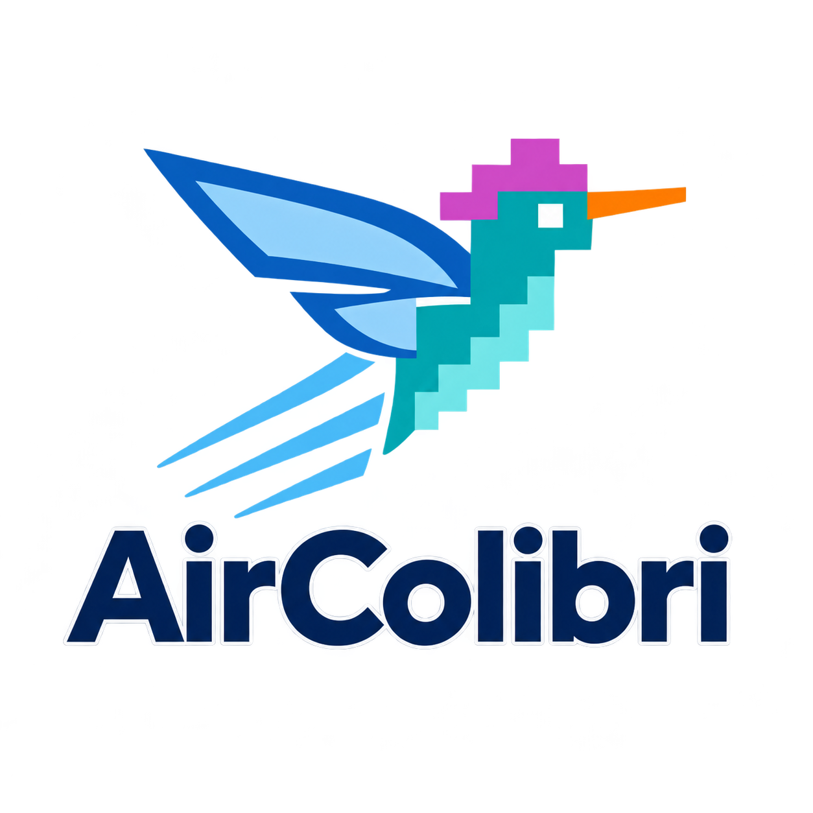

<p align="center">
  
</p>

# AirColibri

<p align="center">
  <a href="LICENSE"></a>
</p>

Local inference of **Qwen3.5** hybrid models (Gated DeltaNet + attention) on a single consumer
NVIDIA GPU, with an OpenAI-compatible server for your local network.

AirColibri combines ideas from [AirLLM](https://github.com/lyogavin/airllm) (layer streaming,
selective weight reads) and [Colibrì](https://github.com/JustVugg/colibri) (tiered placement,
native MTP speculation) with its own W4A16 (Q4, group 64) weights and NVRTC CUDA kernels.

## Requirements

- NVIDIA GPU with CUDA (tested: RTX 3060 Ti 8 GB; cards with ~4 GB stream part of the layers)
- Python 3.12, PyTorch 2.6 with CUDA 12.4 (`requirements.txt`)
- Windows x64 or Linux

```bash
python -m venv .venv
.venv/Scripts/python -m pip install torch==2.6.0 --index-url https://download.pytorch.org/whl/cu124
.venv/Scripts/python -m pip install -r requirements.txt
```

## Model

The recommended model is **[Qwen/Qwen3.5-9B](https://huggingface.co/Qwen/Qwen3.5-9B)**.
Standard Hugging Face shards (`model-0000X-of-0000N.safetensors` + `model.safetensors.index.json`)
are read directly — no converter and no second copy on disk. On first start the Q4 weights are
built once into `data/q4-g64-cache/`.

```bash
aircolibri doctor --model Qwen/Qwen3.5-9B      # downloads once (~19 GB) and checks the setup
```

You can also point `--model` at a local folder, or place the folder in `models/`; it is then
found automatically (unsupported models such as OLMoE are skipped). Colibrì per-layer containers
(`config.hf.json` + `model-00000.safetensors` …) keep working.

## Usage

```bash
aircolibri doctor                      # GPU, model, VRAM plan, LAN addresses
aircolibri ask "Привет! Кто ты?"       # one answer, streamed
aircolibri chat                        # multi-turn chat (Ctrl+C stops the current answer)
aircolibri serve                       # web chat + OpenAI API on :8787, UDP beacon on :8788
aircolibri discover                    # find AirColibri servers on the LAN
```

On Windows use `aircolibri.cmd` (it picks `.venv` automatically) or `python aircolibri.py`.

### VRAM modes

AirColibri measures the **free** VRAM at start and plans with it — there are no fixed card profiles.

| Mode | What it takes |
|---|---|
| `--vram-mode normal` (default) | almost all free VRAM, keeping a reserve for the OS, the KV/DeltaNet state of `--max-context` tokens and the prefill workspace, so long prompts do not run out of memory |
| `--vram-mode turbo` | all free VRAM with a minimal reserve |

If the model fits, every layer stays resident. Otherwise the remaining budget is split into equal
slots that rotate roles — computing → clean → receiving the next layer's weights — so the next layer
is already on the GPU when the current one finishes, and as many layers as fit stay resident.

Prompts are prefilled in chunks (`--prefill-chunk`, default 512 tokens) and only the last position
is projected onto the 248k-token vocabulary.

### LAN server

| Endpoint | |
|---|---|
| `POST /v1/chat/completions` | OpenAI-compatible, JSON or `stream: true` SSE (`reasoning_content` for `<think>`) |
| `POST /v1/chat/stop` | stops the running generation immediately |
| `GET /v1/models`, `GET /api/info` | model list, node status |
| `GET /` | built-in web chat |

- One generation runs at a time. A new request — or a client that closes its connection, detected
  even during prefill — cancels the running one, and its VRAM is released before the next starts
  (`--no-preempt` queues requests instead).
- Request bodies above `--max-request-bytes` (default 8 MiB) are rejected with 413.
- `--require-auth` enables a Bearer API key (the server is open on the LAN by default).
- The server log is written to `logs/server.log` (rotating, 10 MB × 5; `--log-file`, `--no-log-file`).

## Accuracy and speed

- **Q4 is lossy.** Compared with the original weights, Q4 (W4A16, group 64) logits have a cosine
  similarity of about **0.987–0.993**. "Bit-exact" applies only to the fused kernels versus the
  reference Q4 computation, not versus BF16.
- **MTP speculation does not change the output**: with greedy decoding the text is identical with
  and without MTP (covered by `tests/test_engine_gpu.py`).
- Measured on an RTX 3060 Ti 8 GB, Qwen3.5-9B, all layers resident, 400-token answers, **one answer
  at a time**: ~31 tok/s without MTP; 30–37 tok/s with MTP, depending on how many drafts are accepted
  (43–71 % in our runs — on new text MTP may give no gain). Throughput summed over several parallel
  requests is a different number and is not quoted here.
- `--fast-vocab` is experimental and off by default: it can drop rare tokens on long outputs.

## Tests

```bash
python -m pytest tests -q
```

CPU tests run anywhere; `tests/test_engine_gpu.py` and the model-dependent Q4 tests run only when a
CUDA GPU and a local model are available.

## License & acknowledgments

- **AirLLM:** Gavin Li and contributors — [original project](https://github.com/lyogavin/airllm).
- **Colibrì:** Vincenzo Fornaro / JustVugg and contributors — [original project](https://github.com/JustVugg/colibri).

AirColibri is an independent project licensed under [Apache-2.0](LICENSE). Upstream names and marks
do not imply endorsement; see [NOTICE](NOTICE) and [asset sources](assets/README.md).
Changes are listed in [CHANGELOG.md](CHANGELOG.md).
