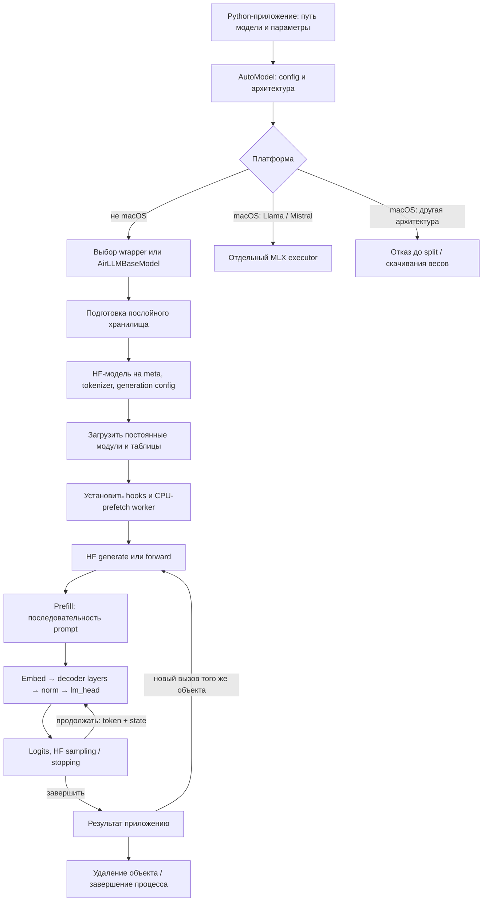
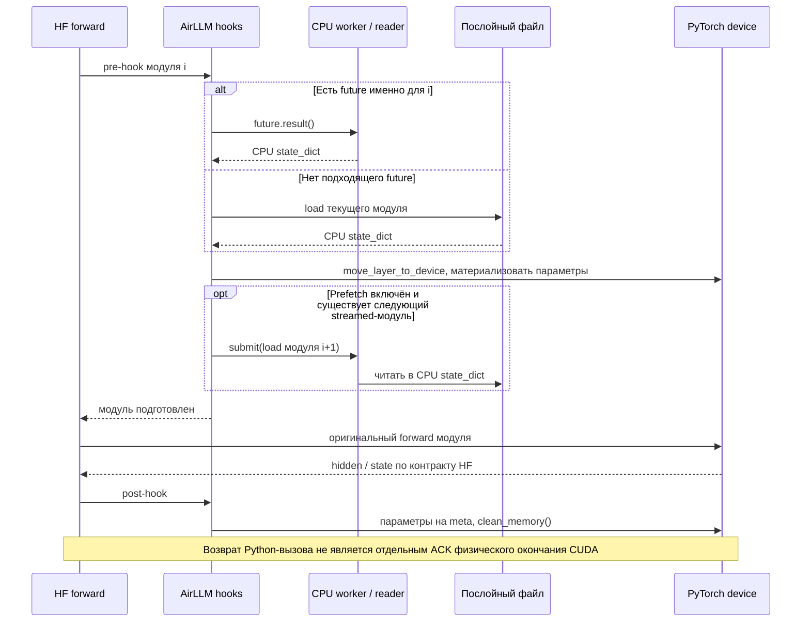
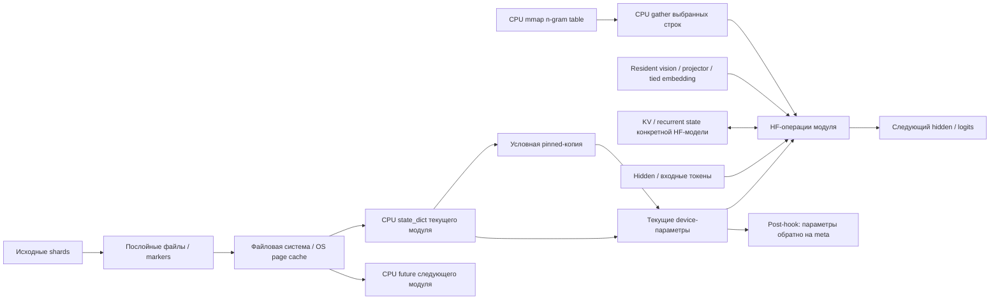
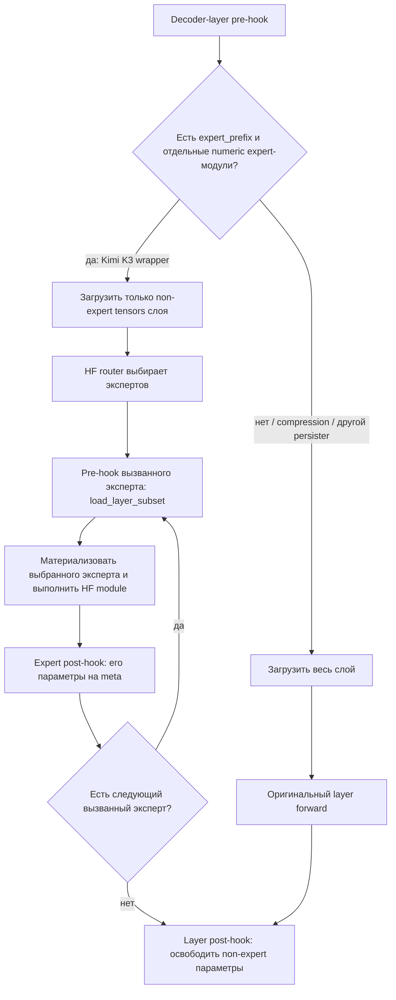
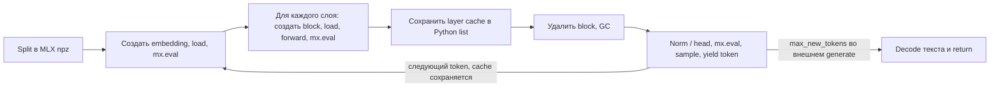

# Оригинальный AirLLM: топология полного жизненного цикла

Дата разбора: 13 ноября 2026. Исходники: **`e496ed3c5c8f614df943b9401cf17e156ef7aca0`**.
Это статический разбор закреплённой версии, а не отчёт о запуске всех поддерживаемых моделей.
Реализация AirColibri в эту схему не включена.

[Общая карта и выводы](ORIGINALS_TOPOLOGY_RU.md) · [Colibrì отдельно](COLIBRI_ORIGINAL_TOPOLOGY_RU.md) · [Указатель исходников](ORIGINALS_SOURCE_INDEX.md)

## 1. Кто управляет процессом

В основной PyTorch-ветке AirLLM создаёт **настоящую модель Transformers с параметрами на `meta`**.
Transformers выполняет модельный `forward` и цикл `generate`; AirLLM ставит hooks на границы модулей,
чтобы материализовать нужные веса перед вычислением и вернуть их на `meta` после него.
Токенизатор, маршрутизатор MoE, attention, KV/recurrent state и критерии генерации относятся
к конкретной HF-модели. AirLLM не заменяет их единым собственным вычислительным графом. [A01–A04]

`generate()` и `forward()` просто делегируют вызов HF-модели. Обычный `forward()` сам по себе
не означает генерацию до EOS: повторные вызовы и передача cache могут принадлежать приложению.
Автоматический долговременный сервер диалогов в этом пути не создаётся. [A04]

## 2. Начало: от исходного checkpoint до работающего объекта

| Этап | Что входит | Что происходит | Что остаётся |
|---|---|---|---|
| Определение | Local path / Hugging Face repo, config | `AutoModel` определяет архитектуру и wrapper | Имена embed/layers/norm/head; особые resident-модули |
| Получение | Config, tokenizer, index / single checkpoint | Для remote сначала metadata; нужные shards подтягиваются при подготовке | Исходный checkpoint/cache HF |
| Разбиение | `weight_map`, `.bin` / safetensors | Тензоры распределяются по модулям; вложенный CPU-resident префикс имеет приоритет | Послойные файлы и `.done` markers |
| Уже готовый split | Файл и marker | Повторная подготовка соответствующего модуля пропускается | Повторно используемый дисковый split |
| Уже один модуль на shard | Несжатый safetensors, подходящий persister | `link_or_copy_file`, без повторной сериализации tensor payload | Ссылка / копия исходного shard |
| Необязательная компрессия | Выбранный режим AirLLM | Компрессия при split, декомпрессия при загрузке | Другая дисковая форма; основной prefetch отключается |
| Каркас | HF config | `init_empty_weights(include_buffers=False)`, большие embeddings сразу на meta; eval, tie_weights | Модули и metadata без всех материализованных параметров |
| Постоянные данные | Config-specific resident-модули, buffers, CPU tables | Загрузка отдельно от streamed-последовательности | Могут жить весь срок объекта |
| Готовность | Model + files | Hooks, при включённом prefetch — один `ThreadPoolExecutor` worker | Объект готов принять вход |

Источники: [A01–A03, A05–A08]. `delete_original` существует как отдельная опция и по умолчанию `False`.
Наличие этой опции в оригинале **не является указанием удалять наши исходные веса**.
Первичная подготовка не равна установившемуся inference: ей нужны место для split и память для
читаемых shards. Общий жёсткий RAM/VRAM budget, как в AirColibri, эта последовательность не устанавливает.

## 3. Середина: один модуль и перекрытие чтения

Последовательность в `_pre_hook`: получить CPU state → переместить текущие веса → отправить
**чтение следующего модуля на CPU**. Это не предварительная DMA следующего модуля в отдельный
GPU-ring slot. В просмотренном основном пути нет своего copy-stream/event/lease протокола.
Синхронизация устройства и lifetime tensor storage остаются за PyTorch/Accelerate. [A04]

`load_layer_to_cpu()` может скопировать CPU tensors в pinned memory, если включён prefetch,
выбрана CUDA и размер слоя не превышает 2 GiB. При ошибке pinning остаются обычные CPU tensors.
Это условное свойство whole-layer пути, не гарантия для каждого `load_layer_subset()`. [A03, A07]

Следующий индекс — следующий элемент списка streamed-модулей. **Автоматического замыкания
последнего слоя на первый слой следующего token-pass здесь нет.** Наш `prefetch_tail_to_head()`
нельзя приписывать исходному AirLLM. [A04]

## 4. Данные, память и владельцы на всём протяжении

| Объект | Владелец | Срок жизни / освобождение | Уточнение |
|---|---|---|---|
| Checkpoint и split | Файловая система | Между запусками; обычно сохраняются | Логический `load` не доказывает физическое SSD-чтение: возможен OS cache |
| Meta-каркас | Объект HF model | Весь срок объекта | Meta — форма/структура, не склад реальных весов |
| CPU state_dict | Текущий loader / Future | Загрузка и материализация; ссылки могут удерживаться Future | Нет постоянного LFRU RAM-кэша этого пути |
| Device streamed weights | Параметры текущего модуля | Pre-hook → выполнение → post-hook | Нет фиксированного preallocated Ring arena |
| Resident modules и buffers | HF model / wrapper | Весь срок объекта | Не освобождаются после каждого слоя |
| Tied embedding/head | HF model | Постоянно при этой ветке установки hooks | Decoder и norm продолжают streaming |
| KV / recurrent state | HF generation / caller | Через decode-итерации, согласно модели и вызову | Не входит в послойную эвикцию весов; не всегда обычные K/V |
| N-gram mmap table | `MmapEmbedding._table` | Весь срок embedding | Обычный attribute, не parameter/buffer; parent `.to(meta)` его не эвиктит |
| CPU prefetch worker | `AirLLMBaseModel._executor` | Весь срок объекта / процесса | Отдельного публичного `close`/drain API в проверенном пакете не найдено |

`clean_memory()` вызывает GC, на Linux пытается `malloc_trim`, затем `torch.cuda.empty_cache()`.
Это не счётчик владения пользовательскими slots и не доказательство немедленного физического
возврата всей памяти ОС/GPU. [A05]

## 5. Развилки, которые нельзя потерять

### 5.1. Обычный слой и выборочные эксперты

`expert_prefix` в проверенной версии задаётся **Kimi K3 wrapper**. Наличие универсальной
функции `load_layer_subset()` не означает, что AirLLM автоматически выполняет выбранных экспертов
OLMoE тем же способом. Qwen4-Exp хранит packed 3D experts на одном модуле; его wrapper прямо
оставляет whole-layer streaming. [A04, A09–A11]

### 5.2. Архитектурные исключения основной ветки

| Wrapper / случай | Отличие топологии |
|---|---|
| Generic HF | Embed → decoder layers → norm → head; math и state у HF |
| ChatGLM / QWen | Другие имена контейнеров и embeddings; собственные tokenizer/config helpers |
| Baichuan / InternLM | Настройки tokenizer / generation config; наследуют основной hook lifecycle |
| Kimi K3 | Resident vision/projector/attention-residual modules + поэкспертные hooks |
| Qwen3.5 / Qwen3.8 dense VL | Resident vision tower; hybrid attention/state внутри HF; MTP-веса исключены из этой последовательности |
| Qwen4-Exp | Resident vision; norm заменён hyper-connection mixer; огромные PLE/n-gram таблицы выделены в CPU mmap; experts читаются целым слоем |
| Tied embeddings | Embedding/head не проходят обычную последовательность eviction |
| Quantized checkpoint | Ветки HF quantizer / verbatim packed payload / decompression; нельзя автоматически считать bytes равными BF16 |

### 5.3. macOS / MLX — отдельный executor

`AutoModel` выбирает `AirLLMLlamaMlx` на macOS и отклоняет явно указанную архитектуру вне
Llama/Mistral. Пустое поле architecture проходит эту проверку, но не доказывает совместимость.
Это собственные MLX `Attention`, `TransformerBlock`, `RMSNorm`, sampling и Python generator,
а не HF forward с hooks. Persister сохраняет `.mlx.npz`; меняет имена параметров под MLX. [A01, A08, A12]

`test_nonlayered=True` сохраняет modules вместо повторного удаления/создания. В обычной layered
ветке веса читаются снова на decode. Явные `mx.eval` — границы ленивого вычисления, существенно
отличающиеся от основного PyTorch hook-пути. В просмотренном wrapper выход внешнего `generate`
ограничен числом новых токенов; не следует переносить на него весь набор HF stopping rules.

### 5.4. LoRA training — дополнительная, не inference-ветка

`AirLLMLoRA` / `AirLLMLoRAQwen4Exp` отключают обычные streaming hooks и используют custom autograd:
forward слоя → CPU-сохранение hidden → eviction base weights → loss → backward с повторной
загрузкой frozen base weights и recompute → gradients LoRA → optimizer step → сохранение adapter.
LoRA-параметры и optimizer state живут отдельно от выгружаемых base weights. Это дополнительный
проход по весам в обратном порядке, отсутствующий в обычной генерации. [A13]

## 6. Конец прохода, следующий запрос, остановка и ошибки

1. **Конец слоя:** post-hook снимает материализованные параметры; hidden/state нужны последующим операциям.
2. **Конец forward:** HF возвращает output; будущий decode снова пройдёт streamed-модули с сохранённым state.
3. **Конец generate:** управление возвращается приложению; model, hooks, resident modules и executor ещё существуют.
4. **Следующий запрос:** файлы split и сам объект переиспользуются. Сохранение/повторная передача cache определяется caller/HF, а не общим AirLLM session manager.
5. **Остановка:** отдельного complete/drain/release протокола для всех ресурсов в проверенном пакете не найдено. Нельзя рисовать симметричный `close()` только потому, что такой API есть в AirColibri.
6. **Ошибка чтения/материализации/forward:** исключение выходит по Python-пути. В исследованном hook-коде нет единого recovery state machine с отменой pending prefetch и подтверждением освобождения CUDA consumers.

## 7. Границы доказательства и что измерять при переносе

Разобраны внешние входы, preparation/persistence, главный hook-путь, resident/CPU-mmap данные,
expert specialization, MLX и LoRA lifecycle. Не выполнялась проверка каждой поддержанной архитектуры,
каждого quantizer, каждой версии HF и всех exceptional paths. Математика внешней HF-модели — отдельный
контракт; её версию и state layout нужно фиксировать для конкретного checkpoint.

Минимальный trace для проверки схемы на модели: request/pass/layer/expert IDs → начало/конец
логического чтения → CPU/pinned bytes → materialize → compute dependency → release → KV/state bytes.
Нужно отдельно мерить physical I/O и peak RAM/VRAM: количество loader calls их не заменяет.

Обозначения источников A01–A13 разрешаются в [реестре с revision, SHA-256 и строками](ORIGINALS_SOURCE_INDEX.md).
