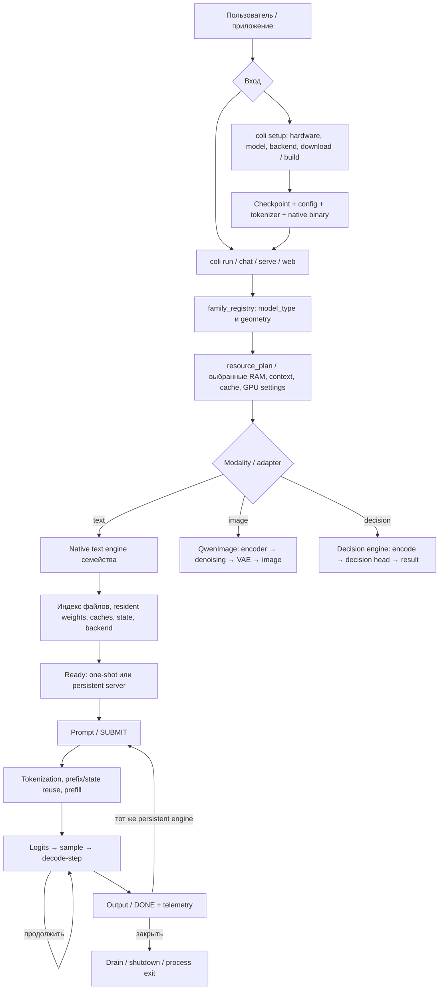
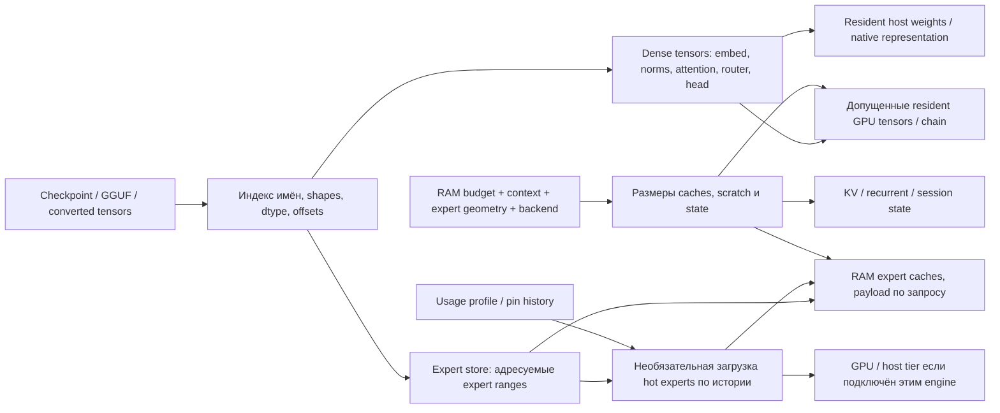
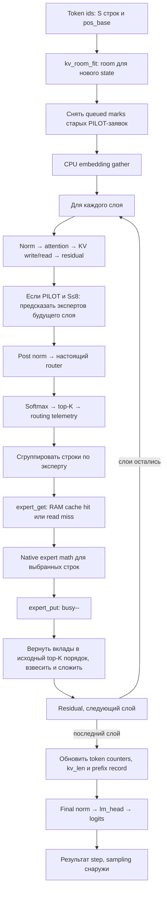
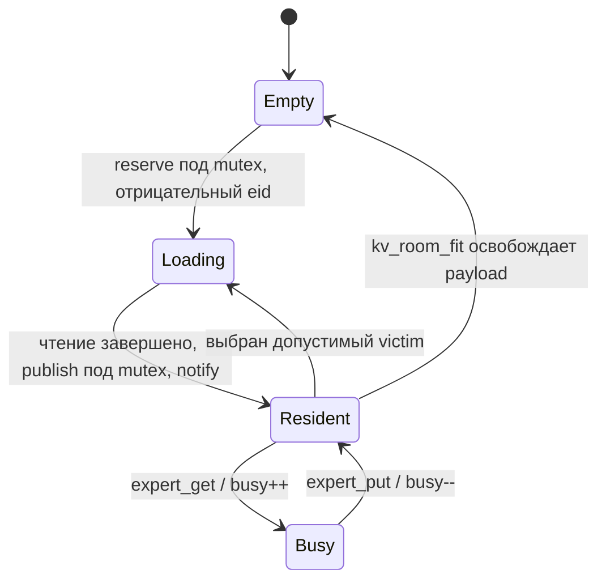
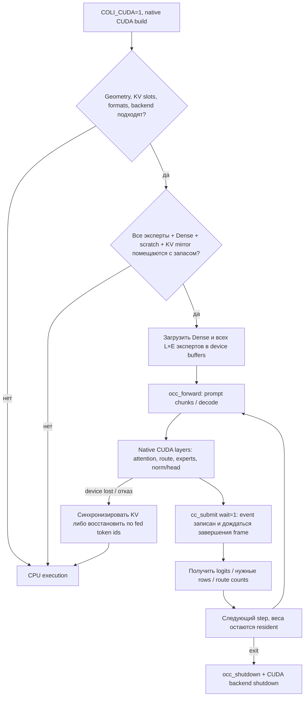
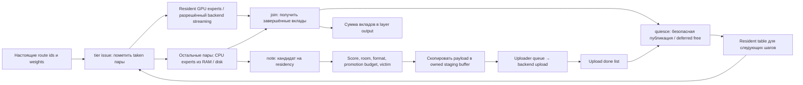
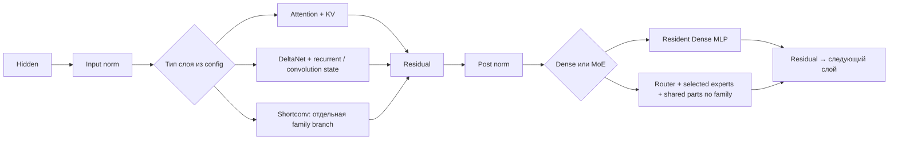
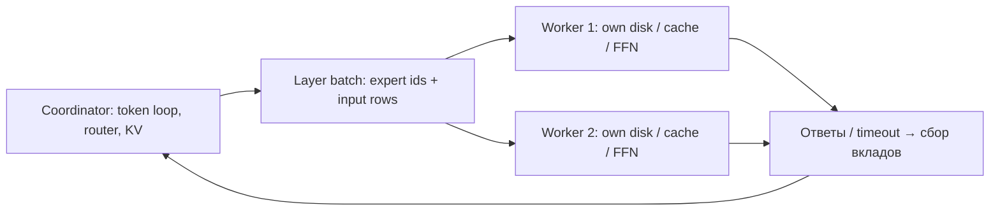
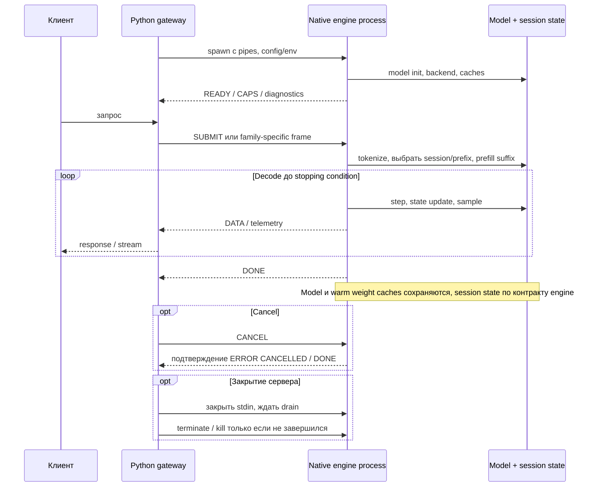

# Оригинальный Colibrì: топология полного жизненного цикла

Дата разбора: 13 ноября 2026. Исходники: **`0a5504a1dc64f86fcd0fe7db298b0448c730e7e6`**.
Это статическая карта закреплённой версии. Она не является runtime-сертификацией всех движков,
backend-ов и моделей. AirColibri и его Python/C bridge показаны отдельно в общей карте.

[Общая карта](ORIGINALS_TOPOLOGY_RU.md) · [AirLLM отдельно](AIRLLM_ORIGINAL_TOPOLOGY_RU.md) · [Исходники](ORIGINALS_SOURCE_INDEX.md)

## 1. Верхний уровень: это семейство движков

Colibrì состоит из Python control plane, семейства native executors и общих подсистем хранения,
телеметрии, RAM/GPU tiers, state и serving. **`c/colibri.c` — GLM-движок, а не универсальный forward
для всех моделей. `c/tier.h` — небольшая библиотека оценки, а не весь control plane.** [C01–C04]

Планирование — оценка до запуска и передача настроек; runtime caches и executor затем владеют
реальными allocations. `projected_hit_rate` планировщика не является измеренным hit rate.
Файлы весов могут быть разделены по дискам; это свойство family-specific input path, не отдельная
копия каждой модели в RAM. [C01–C03]

## 2. Реестр всех входных веток этой версии

Таблица получена из `FamilyDescriptor` в `family_registry.py`, а не из названия модели в README.
Это **карта dispatch**, не утверждение одинакового backend coverage. Полные model_type aliases
и исходные строки сохранены в [JSON evidence](evidence/2026-11-13/original-topology.json). [C01]

| Family id | Native artifact | Тип пути |
|---|---|---|
| `glm53` | `glm53` | Text / hybrid family |
| `glm` | `colibri` | Text; GLM / Mistral-family aliases |
| `inkling` | `inkling` | Text; через gateway adapter |
| `kimi` | `kimi_k3` | Text; через gateway adapter |
| `olmoe` | `olmoe` | Text; attention + routed MoE |
| `qwen36` | `qwen36` | Text; Dense и MoE, attention / DeltaNet / family-specific shortconv |
| `qwen38` | `qwen38` | Text; Qwen4-Exp architecture aliases |
| `deepseek_v4` | `deepseek_v4` | Text |
| `deepseek_v41` | `deepseek_v41` | Text; gateway adapter |
| `mimo` | `mimo` | Text; gateway adapter |
| `qwen_image` | `qwenimage` | Image, без autoregressive KV/MoE цикла text engine |
| `laya` | `laya` | Decision; native DECIDE, без text generation |
| `gliner_decide` | `gliner_decide` | Decision; native DECIDE |

Наличие `has_gateway_adapter` не означает наличие прямого CLI adapter: `coli run` для ряда
семейств обращается через gateway. Возможность chat/vision/decision уточняется handshake
**реально запущенного engine**, в том числе `CAPS`; одних config flags недостаточно. [C01, C02, C05]

Ветка Clef — decision head поверх Qwen backbone; её не следует считать ещё одним универсальным
text engine. Image и decision paths включены в границы продукта, но их kernel-level topology
не используется для объединения AirLLM/LLM inference и здесь не аудировалась по всем kernels.

## 3. Начало text inference: что и куда загружается

Конкретные формы различаются. OLMoE CPU читает converted `merged_weight` + `qs` либо GGUF blocks;
слот содержит native gate/up/down payload и scales, а не Python BF16 state_dict. Loader проверяет
форму/размер перед записью. Шардовый `st.h` поддерживает адресные чтения, optional mappings и
platform-dependent I/O; файл и OS page cache остаются отдельными уровнями. [C06, C07]

Для Dense-моделей ветка экспертов может отсутствовать полностью. В `qwen36` Dense MLP остаются
resident; экономия на cold experts к ним автоматически неприменима. Одного названия
«streaming engine» недостаточно, чтобы сделать вывод о послойной выгрузке всех Dense weights. [C14]

## 4. OLMoE CPU: точный путь внутри одного forward

Это подробно разобранный native CPU путь для семейства, которое используется в текущем
AirColibri MoE experiment. Его нельзя автоматически переносить на GLM/Qwen. [C06–C09]

При chain backend финальный head может быть уже выполнен на device к моменту обновления
host token counters/prefix.
Группировка prefill обрабатывает эксперта для нескольких выбранных строк за одно получение
слота. Поэтому число cache hits в оригинале может включать повторное применение внутри batch;
сравнивать его с cache-hit counter нашего per-expert loader без нормализации нельзя. [C08]

### RAM-слот: владение и конкурентное чтение

`expert_get` выполняет lookup **в cache конкретного layer**. При miss выбирает свободный slot
или victim; не перезаписывает busy/in-flight payload. Demand read при необходимости ждёт
condition variable. Резервирование и публикация происходят под mutex, само чтение — вне lock.
Demand-get на freshly loaded slot публикует его сразу занятым для потребителя. [C07]

`pinned` в `Slot` означает **запрет обычной эвикции hot expert**, а не CUDA pinned host memory.
Это разные свойства с разными владельцами. Под давлением demand path может снять pin, но
не перескакивает защиту busy/in-flight. [C07]

### PILOT: отдельный speculative read path

После attention residual прогнозируется router будущего слоя; `PILOT>=2/3` расширяет lookahead
после текущего MoE residual. Используются destination norm/router, optional smoothing и
confidence, затем очередь запросов worker-у. Данные читаются **в RAM expert cache**. Это не
замена результата настоящего router и не CUDA tail-to-head transfer. [C08, C09]

Worker пропускает устаревшие, уже resident/in-flight и недопустимые заявки. LFRU guard может
отказать speculative replacement тёплого resident expert. Новому forward не нужно откатывать
ring queue indices: очищаются queued marks, worker дренирует stale entries. OLMoE PILOT worker
создаётся detached и имеет бесконечный цикл; CLI model сделана static, чтобы worker не получил
висячий pointer перед exit. Универсального join этого worker в CLI-пути здесь нет. [C07, C09]

### KV растёт — RAM cache сокращается

`kv_room_fit()` вызывается перед записью следующих позиций. Из общего room вычитается KV,
пересчитывается число slots/layer, вытесняются допустимые LRU entries, при необходимости ожидаются
busy/in-flight, payload освобождается. Host pool GPU tier также может уменьшить RAM cache через
callback `ram_given`. Здесь управление — связь реальных подсистем, а не только функция score. [C07, C10]

## 5. OLMoE CUDA: другой маршрут, полная residency экспертов

`occ_start()` проверяет объём **всех** экспертов, scratch и KV mirror с запасом 768 MiB.
Он читает экспертов при setup независимо от demand CPU cache и размещает их в общем device buffer.
Это **не ограниченный CUDA кэш с двумя retained experts**. При `KV_SLOTS>1` этот chain отклоняется.
Vulkan, если выбран, имеет приоритет перед этим CUDA chain. [C11]

`cc_submit(1)` синхронизирует recorded CUDA event. В backend также есть отдельные stream/event
механизмы async fetch, но их наличие не означает, что OLMoE `occ_forward` использует их как
наш GPU Ring. При fallback необходимо восстановить state, а не просто выбрать CPU для
следующей матрицы: device может владеть более свежими KV rows. [C11, C12]

## 6. Vulkan expert tier и CUDA-порт общего tier

OLMoE Vulkan может использовать common `vk_tier`, CPU/GPU split работы экспертов и dense chain.
Отдельный `cu_tier.c` компилирует ту же логику tier поверх CUDA operations table для движков,
которые её подключили. **Наличие `cu_tier` не превращает OLMoE `occ_start` в этот путь.** [C10–C13]

Общий tier имеет таблицу `(layer,eid)`, ограничение bytes/slots, форматы, очередь uploader,
staging ownership, deferred evictions и `inflight`/join boundaries. `vkt_note()` копирует source
bytes в собственный staging buffer до возврата; поэтому uploader не обязан удерживать caller's
RAM-slot навсегда. `quiesce()` не освобождает занятые device allocations. Upload completion и
публикация новой residency — разные события. [C10]

`vkt_shutdown()` останавливает и join-ит uploader, ожидает in-flight device batches, освобождает
очереди и resident expert resources. Это иной lifecycle, чем detached OLMoE PILOT worker.
Их нельзя объединять на схеме одним безымянным «prefetch thread». [C10]

В заголовке `cu_tier.h` данной версии прямо перечислены ограничения CUDA-порта: нет всех
возможностей Vulkan (в частности streaming / второго device / некоторых low-bit formats и
dense-chain expert table этого интерфейса). Поддержку нужно подтверждать для **конкретного
backend + family + format**, а не по существованию одноимённой функции-заглушки. [C13]

## 7. Что на самом деле делает `tier.h`

| Часть | Входы и выходы | Кто владеет остальным |
|---|---|---|
| `tier_should_promote` | `hot > cold + cold/4 + 4` | Вызывающая сторона решает, когда и к чему применять |
| `tier_pick_lfru` | Heat, last access, clock, candidates, resident IDs → candidate/victim | Не читает и не перемещает веса |
| LFRU score | Частота и ограниченная recency | Caller задаёт событие доступа, область сравнения и clock |
| `tier_decay` | Halve массива heat | Caller выбирает cadence и массив |

В GLM `repin_pick()` вызывает `tier_pick_lfru` с **per-layer arrays**, затем `repin_pass_limit()`
исполняет выбранные замены и decay; период зависит от emitted tokens и `REPIN`. В общем GPU tier
heat хранится по `(layer,eid)`, есть placement/format classes и decay cadence 1024 tokens
на границах forward. OLMoE CPU использует собственную pin/warmup/PILOT/LRU логику. [C04, C10, C15]

Следовательно, «подключена оригинальная C-функция» и «воспроизведён оригинальный scheduler» —
разные проверяемые утверждения. Для второго требуются те же events, candidate scope, budgets,
данные о residency, actuation и правила подтверждения.

## 8. Qwen: Dense/MoE и state, которые не укладываются в одну KV-картинку

`qwen36` выбирает внутри слоя attention либо DeltaNet, а для отдельных семейств shortconv;
после residual идёт Dense/MoE ветка `moe()`. Prefill/decode повторяют этот model-specific graph.
Vulkan/CUDA chains и CPU remainder имеют отдельные dispatch/recovery paths. [C14]

MTP — optional отдельная ветка draft/verification/state rollback; `qwen36.c` подключает
`qwen36_mtp.h` и `qwen36_mtp_cuda.h` и подаёт hidden rows в MTP state. Наличие этих файлов
не означает, что MTP активен по умолчанию или уже подключён в AirColibri. В эту карту включена
его граница; математический draft/acceptance path требует отдельного model-specific аудита.

`CACHE_ROUTE` тоже отдельный рычаг: в поддержанных engines может **изменить набор выбранных
экспертов** ради residency; по документации оригинала выключен по умолчанию. PILOT прогнозирует
загрузку, не подменяя реальные route ids. Для parity-ориентированного объединения эти механизмы
нужно оценивать раздельно. [C16]

### Другие аппаратные и распределённые ветки

**Metal / unified memory:** это ещё один optional backend, а не CUDA с другим названием.
Документация оригинала описывает batched expert math из RAM slabs без отдельного PCIe-copy,
command-buffer grouping, отдельные attention/GEMM paths и CPU fallback; исходный `qwen36`
также подключает Metal affine expert-store dispatch. Точность и набор операций зависят от
ветки; upstream performance numbers здесь не переносились на наш компьютер. [C18]

**Cluster:** в documented expert-worker topology token generation, router и KV остаются
у coordinator, а выбранные FFN batches отправляются workers, у которых свои disk/cache/compute.
Ответы собираются перед продолжением слоя. Это другой ownership domain: локальный GPU ACK
не заменяет network request lifetime/timeout. Segment/edge APIs — дополнительные границы
исполнения; их нельзя считать тождественными expert-worker mode. [C19]

Metal и cluster включены как самостоятельные ветки карты. Это обзор их исходных интерфейсов
и документации; все kernels/transport recovery paths в этом проходе не проверялись.

## 9. Serving, повторные запросы, остановка и ошибки

В OLMoE prefix ledger записывает IDs, соответствующие реальному KV. Следующий prompt может
переиспользовать совпавший prefix и досчитать suffix. При нескольких KV slots модельные веса
общие, состояния диалогов раздельны; decode rows могут группироваться. Prompt cancellation
на CPU проверяется между слоями, оставляя прежнюю committed KV length; stale tail перезапишется.
Это сложнее, чем очистка всех весов и новый cold start после каждого ответа. [C09, C17]

При аварии engine gateway может продолжить жить и перезапустить subprocess (`keep_engine`).
Это не доказательство автоматического сохранения всех in-memory состояний сессии. Normal close
сначала завершает pending requests, закрывает stdin и ждёт; затем при необходимости завершает
процесс. В Windows есть job ownership для дочернего engine. [C05]

Конец CLI-run и конец embedded/segment session различаются. У OLMoE CLI часть памяти живёт до
process exit; отдельные segment/edge APIs содержат собственные destroy/free functions. CUDA chain
регистрирует shutdown через `atexit`; общий tier имеет явный shutdown. Нельзя изображать один
универсальный `model_free()` на всех выходах. [C09, C11, C17]

## 10. Сводка владельцев

| Объект | Владелец | Граница reuse / release |
|---|---|---|
| Checkpoint и indices | Native file store, OS | Исходные bytes между запусками; mappings/FD — по backend |
| Resident Dense / global weights | Конкретный native Model / device chain | Живут между слоями и запросами; device-only offload может снять host copy |
| CPU expert slot | Per-layer cache | Publish после read; busy защищает compute; eviction только допустимого slot |
| Hot pin | Cache policy | Логическая защита от eviction, не CUDA host pinning |
| PILOT request | Очередь/worker OLMoE | Может стать stale; speculative miss можно пропустить |
| Tier staging | Common tier uploader | Own copy payload; освобождается после обработки queue |
| GPU resident expert | Backend tier / full chain | Join/quiesce либо постоянная residency до shutdown, зависит от ветки |
| Hidden/scratch | Forward/chain buffers | По step/chunk, повторно используются после завершения consumers |
| KV/recurrent state | Session / model / device mirror | Через decode и разрешённый prefix reuse; backend transition требует актуального state |
| Usage heat/profile | Engine telemetry / policy | Runtime counts; optional file persistence; это не weights |
| Процесс engine | CLI/gateway | READY → requests → drain/exit; server может быть отдельным процессом |

## 11. Полнота и оставшиеся границы

Покрыты начало, steady-state, prefill/decode, repeated requests и завершение на уровне dispatch
продукта; подробно — OLMoE CPU, OLMoE full-resident CUDA и общий GPU-tier contract; отдельно —
Qwen layer/state differences и GLM repin context. Family dispatch перечислен полностью по registry.
Не выполнен аудит каждой арифметической операции остальных text engines, всех optional
formats/devices, cluster transport и MTP acceptance/recovery. Эти ветки отмечены, а не объявлены
эквивалентными уже исследованным.

Следующая проверка совместимости должна выбирать **точный путь family/backend/format/state**.
Без этого «смешать AirLLM и Colibrì» не задаёт однозначную программу исполнения.
