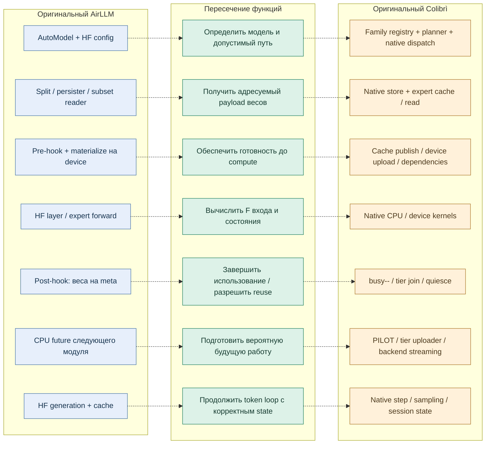
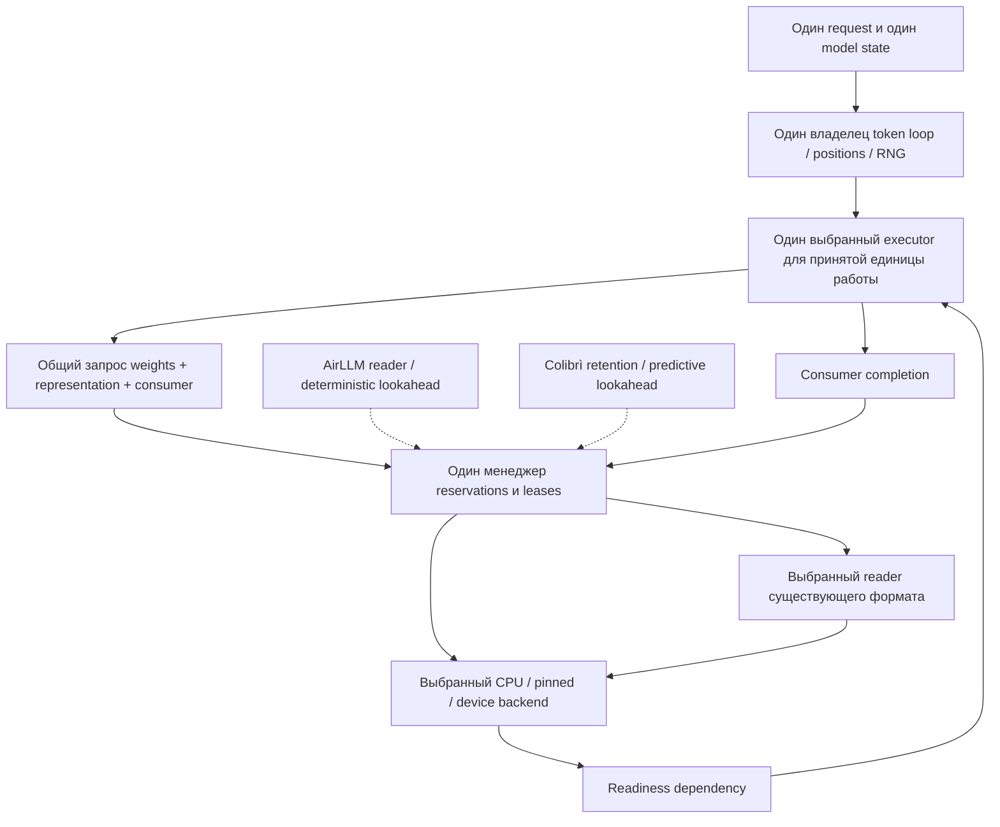

# Функциональное наложение AirLLM и Colibrì

13 ноября 2026. Основа: [две исходные топологии](ORIGINALS_TOPOLOGY_RU.md), закреплённые
исходники и [дополнительная AST-сверка Graphify](GRAPHIFY_AUDIT_RU.md).

**Главное пересечение — цикл «получить необходимые веса → обеспечить готовность → вычислить
с ними → безопасно закончить использование».** AirLLM привязывает этот цикл к HF-модулям;
Colibrì — к своим native слоям, expert caches и device tiers. Единая функция здесь возможна
на уровне контракта данных и lifetime, но не означает одинаковую реализацию.

Второе пересечение — подготовка следующей работы заранее. Третье — продолжение генерации
с накопленным state. В обоих случаях конкретные предсказатели, владельцы и способы синхронизации
различаются. Именно эти различия определяют, как механизмы могут дополнять друг друга.

## 1. Наложение по функциям

Пунктир означает **сопоставление ролей**, а не реальный вызов между программами. Центральные
блоки — общий смысл функции. Это аналитическое наложение, не уже реализованный общий executor.

## 2. Где они делают одно и то же — и насколько буквально

«Общая функция» ниже означает одинаковую обязанность в процессе. «Частично» — совпадает
цель, но различаются единица работы, момент применения или контракт. Это не доказательство
численной эквивалентности и не автоматическое разрешение заменить один вызов другим.

| ID / функция | AirLLM | Colibrì | Пересечение и граница |
|---|---|---|---|
| F01. Разрешить модель | `AutoModel`, architecture → wrapper/HF | `resolve_model`, family → native artifact | **Общая функция.** Единый descriptor возможен, списки поддержанных моделей различны. [A01, C01–C02] |
| F02. Сделать веса адресуемыми | Split по модулям, markers, safetensors/MLX persister | Индекс имён/offsets; converted expert tensors/GGUF; format-specific stores | **Частично.** Общий адрес `model/object/representation`; физическая упаковка и подготовка разные. [A06–A08, C06–C07] |
| F03. Прочитать требуемые веса | `load_layer`, `load_layer_subset` | `expert_get` при miss → `load_expert_merged`/store | **Общая функция.** На hit Colibrì читать заново не нужно; источник и формат нельзя смешивать. [A07, C07] |
| F04. Подготовить представление | Decompression, HF quantizer или verbatim packed values | Native int8/scales, GGUF blocks, device format | **Частично.** Одинаковая цель — пригодный для выбранного kernel payload; layouts и точность не тождественны. [A03, C07, C10–C13] |
| F05. Разместить для compute | `move_layer_to_device`, параметры модуля | CPU resident/cache, optional GPU tier, native chain | **Частично.** AirLLM hook обычно материализует текущий модуль; Colibrì может оставить hot weights и выполнять warm experts на CPU. [A03–A04, C07, C10–C11] |
| F06. Не начать compute до готовности | Pre-hook завершает материализацию; framework device ordering | Cache publish/busy, upload completion, issue/join/chain ordering | **Общая зависимость.** Готовность нужна обоим; конкретные events/locks различны. [A04, C07, C10–C12] |
| F07. Выполнить модельную операцию | Делегированная HF математика | Собственная native математика | **Общая математическая роль, разные исполнители.** У AirLLM это не второй собственный HF-compatible C graph. [A02, A04, C08, C11, C14] |
| F08. Выбрать экспертов | Router HF; отдельные hooks только где module layout позволяет | Native router, top-K, grouping | **Общая роль router.** Kimi hook не равен универсальному OLMoE streaming; `CACHE_ROUTE` отдельно может менять top-K. [A04, A09, C08, C16] |
| F09. Продолжить с state | HF/caller KV либо recurrent cache | Native session KV/recurrent state/device mirrors | **Общая функция, несовместимые по умолчанию representations.** Нужны positions, shapes, dtype, ownership и rollback rules. [A04, C11, C14, C17] |
| F10. Закончить использование | Post-hook → meta; framework storage lifetime | `expert_put`, GPU join, deferred free/quiesce | **Общая обязанность, различная семантика.** Убрать Python parameter не равно наблюдать GPU completion. [A04–A05, C07, C10–C12] |
| F11. Предзагрузить будущую работу | Следующий известный streamed-модуль в CPU future | PILOT предсказывает будущие experts; tier uploader размещает кандидатов | **Частично.** Один знает порядок слоёв, другой прогнозирует ветвление; оба конкурируют за I/O, RAM и copy bandwidth. [A04, C08–C10] |
| F12. Сохранить полезные веса | Resident exceptions, tied embeddings; нет общего LFRU cache этого пути | RAM LRU/hot pin, native repin, device tier | **Асимметрично.** Здесь Colibrì дополняет AirLLM, но только поверх согласованного lifetime. [A03–A04, C07, C10, C15] |
| F13. Учитывать доступную память | Layer streaming + отдельные fit/pinning ограничения | Planner, cache cap, `kv_room_fit`, tier budgets | **Частично.** Ни одна локальная формула не заменяет общий ledger всех реальных allocations интеграции. [A03, C03, C07, C10] |
| F14. Завершить генерацию | HF stopping / caller | Native sampling, stop IDs, served request completion | **Общая функция.** Нужен один хозяин token progression и RNG для конкретного request. [A04, C05, C17] |
| F15. Обслужить следующий запрос | Повторный вызов Python object, cache по caller/HF | Persistent engine, prefix/session reuse, batch slots | **Асимметрично.** Server/session management в Colibrì шире; это слой над engine contract. [A04, C05, C17] |
| F16. Закрыть / восстановить | Нет общего explicit close/drain/recovery протокола в этом пути | Разные process/tier/chain/session shutdown и fallback | **Асимметрично.** Единый lifecycle нужно определить в интеграции и связать с исходными hooks/owners. [A04, C05, C09–C13] |

## 3. Точные места встречи в одной логике

### До вычисления: запрос весов

HF module pre-hook и native `expert_get()` возникают из одного факта: **следующей операции
нужен конкретный объект весов**. Это точка общего `acquire(object, representation, consumer)`.
На hit он возвращает lease существующего payload; на miss организует чтение и готовность.
Router/математика при этом не должны зависеть от того, был ли объект в кэше.

Следовательно, можно совместить AirLLM addressable reader и Colibrì retention policy через
один manager. Запуск обоих целых loaders на каждый miss не нужен. Reader выбирается по
представлению данных, а не по принципу «использовать сразу обе программы».

### После отправки compute: конец владения

HF post-hook и native `expert_put()` обозначают завершение области использования на своём
уровне. Для CPU это часто конец синхронной функции. Для CUDA нужен ещё факт завершения
последнего consumer. Общая точка — **release intent + completion dependency**, после которой
manager вправе удержать объект resident, переместить его или эвиктить.

Именно здесь retention дополняет streaming: streamed forward не обязан решать судьбу веса
после себя; он обязан честно вернуть владение. Наш ACK уже реализует часть этой границы,
но полный общий scheduler от этого автоматически не появляется.

### До следующего слоя: будущие потребности

AirLLM знает следующий модуль. Colibrì PILOT оценивает будущих экспертов по hidden state.
Это разные **производители заявок на будущие объекты**. Их можно подключить к общей очереди,
оставив demand выше speculative work, ограничив pending bytes и убирая stale requests по epoch.
Предсказатели не должны сами безусловно перезаписывать буферы.

### На границе прохода: состояние и корректировка размещения

У обеих программ есть проход, после которого получены logits и обновлён state. Это удобная
граница для commit новых placement decisions, пересчёта state budget и осторожной смены
executor. Но «граница forward» сама по себе не гарантирует, что все async consumers завершены:
нужен fence именно затрагиваемых объектов.

## 4. Где возникло бы дублирование

Это **предлагаемая схема объединения**, не описание уже готовой реализации.

| Возможный конфликт | Почему мешает | Как разделить обязанности |
|---|---|---|
| Два independent token loops | Двойное продвижение позиции/cache; расходится sampling/RNG | Один request driver; другой engine предоставляет forward/step либо живёт в отдельном режиме |
| Два readers одного объекта/представления | Повторный disk/CPU payload, лишняя память и гонка публикации | Один cache miss owner; остальные присоединяются к его pending result |
| Два allocator/evictor одного slot | Один освобождает память, пока другой ещё вычисляет | Единственная authority реальных placements; политики возвращают предложения |
| Два prefetch workers без общей очереди | Спекуляции вытесняют обязательный read, переполняют staging | Общие priority, byte budgets, deduplication и stale disposal |
| AirLLM post-hook уничтожает retention | Следующий hit указывает на payload, который уже снят/перезаписан | Meta-отвязка module parameters отделяется от lifetime retained storage |
| Два счётчика «heat» с разными единицами | Одинаковый decay number имеет разный смысл | Явно задать token/row/access event, candidate scope и period |
| Две формы весов объявлены одним объектом | Неверный kernel/layout, повторная декомпрессия или скрытая quantization error | Representation входит в identity; conversion имеет отдельный output и bytes |
| Две версии KV/state | Backend продолжает с устаревшими positions/rows | Один committed state version; migration только через snapshot/restore contract |

RAM cache и GPU cache сами по себе **не являются дублированием**: это разные уровни.
Две формы одного веса тоже могут быть полезны. Лишняя копия возникает, когда нет объяснимой
роли, учёта bytes и владельца. Общая система должна учитывать копии, а не запрещать их по имени.

## 5. Что не совпадает напрямую

- **HF/PyTorch, native C и MLX** — альтернативные исполнители со своими state/layout/numerics.
  Их логическое место — backend selection и проверяемые границы миграции, не одновременное
  выполнение одного принятого token-step тремя владельцами.
- **OLMoE full-resident CUDA chain** — режим для достаточной VRAM. Он дополняет малопамятный
  путь как другой профиль запуска, но не становится streaming chain только от добавления policy.
- **MTP** — отдельная стадия draft → verify → commit/rollback. Она требует speculative state;
  её нельзя подмешать в обычный KV как «ещё одну предзагрузку».
- **CACHE_ROUTE** — режим изменения модели исполнения ради residency. Включать только в
  отдельном quality track; при строгой route parity ему места в основном пути нет.
- **Metal, Vulkan, CUDA** — аппаратные варианты. Их нельзя произвольно расположить во времени
  одного Windows/CUDA запуска, если устройство/backend не поддержаны.
- **LoRA training** — отдельный жизненный цикл с backward/recompute и optimizer state;
  training и inference можно разделять по сеансам/версиям весов, не смешивать mutable и frozen payload.
- **Image/decision/cluster** — расширения внешнего executor/service contract. Они не нужны
  для первого общего Dense/MoE weight lifecycle и не должны усложнять его основной путь.

## 6. Что добавил Graphify и где его пришлось поправить

Полные исходные AST-графы построены отдельно: **AirLLM 715 узлов / 1 467 связей**,
**Colibrì 24 210 / 69 599**. Например, Graphify нашёл путь
`_pre_hook → _load_streamed_layer → load_layer_subset`; исходник уточняет условие последнего
перехода — expert-specialized layer path, а не каждый слой любой модели.

Найдена и конкретная ложная связь: `olmoe.c::expert_get → tests/...::sleep_ms`.
В реальном `olmoe.c` это platform macro `Sleep/usleep`, а не вызов теста. Кроме того,
`vkt_note`/`vkt_join` nodes указывают на declarations в header, тогда как поведение определено
в `.c`. Эти места исправлены **в интерпретации карты**; raw Graphify output сохранён без
маскировки дефектов. Поэтому функциональное наложение опирается на source anchors, а не на
любую автоматически нарисованную стрелку.

Результат наложения переводится в [план объединения и временного размещения механизмов](INTEGRATION_INTERSECTIONS_PLAN_RU.md).
