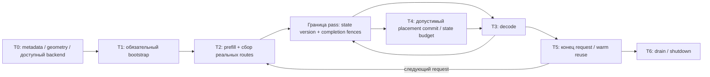
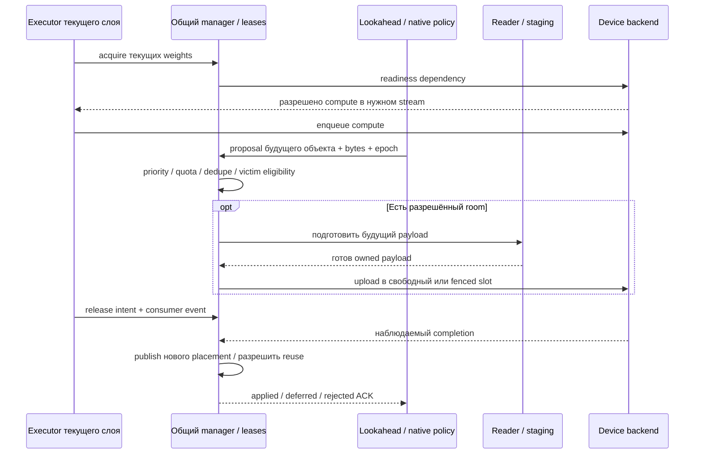

# План объединения точек пересечения и распределения механизмов во времени

13 ноября 2026. Основание: [функциональное наложение](FUNCTIONAL_OVERLAY_RU.md),
[AirLLM отдельно](AIRLLM_ORIGINAL_TOPOLOGY_RU.md), [Colibrì отдельно](COLIBRI_ORIGINAL_TOPOLOGY_RU.md).
Это план следующего этапа. Положительные результаты уже сделанных тестов отделены от новых
контрактов, которые ещё предстоит реализовать и проверить.

**Цель:** один жизненный цикл объекта весов и один согласованный model state, к которым
разные исходные механизмы подключаются в подходящие моменты. Сначала убрать конфликт
владельцев и единиц учёта; затем измерить, дают ли сочетания выигрыш.

## 1. Что объединяем, что оставляем разным

| Общая точка | Единый контракт | Разные реализации/принципы |
|---|---|---|
| Identity / addressing | `model_revision + object_id + representation` | Layer tensor set, selected expert, Dense globals; split safetensors / native store / GGUF |
| Запрос данных | `acquire(object, consumer, deadline, epoch)` | Demand read, RAM hit, GPU hit; выбор одного существующего reader-а |
| Размещение | `reserve → prepare → ready → acknowledge` | CPU cache, pinned staging, GPU Ring, допущенный native tier |
| Конец использования | `release_intent + consumer_completion` | Синхронный CPU completion, CUDA event, native tier join |
| Предзагрузка | `predict → bounded request → dedupe → stage/publish` | Известный следующий слой AirLLM; PILOT predicted experts; tail-to-head на границе проходов |
| Решение retention | `proposal(objects, victims, bytes, expected_epoch)` | LRU/LFRU/native repin, fixed residency, разные phase policies |
| State | `snapshot/version/position → restore → validate → commit` | HF KV, DeltaNet/conv state, native KV mirrors; поддержка явно по family |
| Телеметрия | Согласованные timestamps и единицы | CPU read, physical I/O, H2D, compute, cache events, plan/actual bytes |

Политика предлагает, **один resource manager исполняет**. Loader не выбирает model math;
executor не эвиктит чужой retained payload. Prefetch не изменяет истинный route selection.
Разные strategies могут использовать один backend; разные backends обязаны соблюдать один
ownership contract в той части, которую реально поддерживают.

Текущее AirColibri уже имеет reader bridge, native scoring bridge, shared Ring и часть ACK.
Нужно расширять их после проверки точного контракта, а не создавать третий независимый
загрузчик и ещё один cache manager рядом.

## 2. Место во времени

Граница pass не является обязательной глобальной синхронизацией GPU после каждого слоя.
Операция ждёт зависимости **своих** объектов; глобальный drain нужен для shutdown и для
переходов, где невозможно безопасно сохранить частичную конкурентность.

| Окно | Основная работа | Что может её дополнять | Что в это окно запрещает контракт |
|---|---|---|---|
| T0. До allocations | Config, source identities, object sizes, backend capabilities, budget | Выбрать profile: streaming / resident / native-compatible | Объявлять неподдержанный format/device рабочим; запускать тяжёлую подготовку до fit checks |
| T1. Bootstrap | Globals/state structures и первые обязательные weights | Заранее читать ближайший известный слой в ограниченный CPU slot | Спекуляциями задерживать обязательный путь; обещать TTFT-выигрыш без startup-inclusive замера |
| T2. Prefill | Последовательность слоёв, настоящие routes, grouped rows где executor это поддерживает | Собирать heat; deterministic next-layer reads; кандидаты retention по фактическому reuse | Слепо применять decode-предиктор к большому S; менять routes ради hits в parity-пути |
| T3. Compute текущего layer/expert | Readiness → compute → completion dependency | CPU read следующего layer; PILOT для ближайших experts; подготовка свободного staging | Перезаписывать payload, пока DMA читает его либо consumer ещё вычисляет |
| T3→T4. Безопасная граница | Подтвердить completed consumers и state progress | Commit retention/eviction; tail-to-head при доступном slot; decay по заданной единице | Принимать stale plan/old epoch; выталкивать занятый victim |
| Перед следующим state growth | Зарезервировать KV/recurrent/scratch delta | Сократить необязательный cache/prefetch, освободить безопасные копии | Вписывать только веса в budget, оставляя state без room |
| T5. Между запросами | Зафиксировать session state и stop reason | Сохранить warm weights/usage; разрешённый prefix reuse; подготовить следующую сессию | Считать cache одного запроса валидным для другого без identity/prefix check |
| T6. Shutdown/cancel | Закрыть admissions, инвалидировать speculation, дождаться нужных consumers | Drain pending reads/uploads, release per backend, записать итог | Освободить referenced memory до completion; принять поздний result в новую сессию |

PILOT исходного OLMoE запускается при `S<=8`; перенос этого условия должен быть явным.
Новый prefill predictor возможен как отдельный эксперимент, а не незаметное снятие исходного guard.

## 3. Порядок приоритетов общей очереди

1. **Обязательный state/scratch room и текущий demand.** Без них следующий корректный шаг невозможен.
2. **Уже известный ближайший объект.** Например, следующий Dense layer.
3. **Предсказанные ближайшие эксперты.** Допускаются, если deadline достижим и есть pending-byte quota.
4. **Долгосрочная retention/migration.** Только если не отнимает ресурсы у более срочной работы.

Это исходная проверяемая policy, не утверждение её оптимальности. Стоимость read/DMA/compute,
точность prediction, I/O contention и phase-specific reuse измеряются; queue priorities можно
сравнивать на одном trace. Если speculative prefetch ухудшает TTFT или throughput, он должен
уметь отступить без изменения вычислительного результата.

Событие «enqueue/record» и событие «completed» хранятся раздельно. Отказ speculation не должен
отменять demand: необходимый объект всё равно исполняется через transient path, если он
помещается в установленный budget.

## 4. Этапы реализации и критерии выхода

| Этап | Изменение | Проверка завершённости | Что остаётся выключенным |
|---|---|---|---|
| E0. Source baseline — **сделано** | Две карты, overlay, Graphify с отмеченными дефектами, pinned source ledger | Нужные функции/branches найдены в source; raw graphs и provenance сохранены | Нет утверждения полного native runtime PASS |
| E1. Нормализация событий | Явные model/run/request/pass/layer/expert IDs; token/row/access clocks; units и candidate scope | Один сохранённый trace объясняет все calls/admissions/decays; повторный replay детерминирован | Новый scheduler не управляет live placements |
| E2. Проверка исходных policy contexts | Сопоставить наш 100-access decay с per-layer GLM repin и common tier token cadence как разными policies | Trace replay + off/shadow показывают причины каждого решения; выбран один точно описанный режим для первого live опыта | Не выдавать одноимённую C-функцию за весь original scheduler |
| E3. Общий object/lifetime ledger | Объединить catalog, actual reservations и ACK; identity включает representation; один placement owner | Peak/pending/resident/state bytes сходятся с фактическими allocations в заявленной области; stale/duplicate/rejected outcomes проверены | Автоматическая migration compute backend |
| E4. Reader и prefetch arbitration | Подключить существующий AirLLM reader и deterministic lookahead через bounded queue; demand присоединяется к pending miss | Один read на одновременный запрос одного объекта/representation; no stale publish; cancel/error не оставляют held slot | PILOT сначала только shadow proposals |
| E5. PILOT + retention в подходящих окнах | Реализовать подтверждённый predictor input/phase; общий admission и actuation, отдельно от true router | Exact routes/logits/state при неизменной HF math; pressure/late-result cases; польза и стоимость относительно demand-only | CACHE_ROUTE и MTP не входят в основной parity путь |
| E6. State pressure и repeat requests | Reserve state growth перед шагом; безопасное shrink/eviction; session/epoch lifecycle | Длиннее текущих 144 tokens, full memory trend, demand liveness, close/reopen/cancel; без ослабления RAM gate | Нет обещания long-run reliability до soak |
| E7. Native math seam | Выбрать существующую native операцию/формат и проверить совместимость; сначала stateless FFN, если supported | Контрольный payload одной representation; shape/dtype/layout и numerical oracle; отсутствие hidden quantization conversion | Полный native chain и CPU→GPU state migration до отдельного gate |
| E8. Executor migration / режимы | Только после E7: полный pass boundary, snapshot/restore всех state components, rollback и backend ownership | Непрерывность positions/cache/RNG; checkpoint/replay; device-failure recovery; startup/migration-inclusive timing | Миграция в середине произвольного незавершённого graph |
| E9. Экспериментальные расширения | MTP, CACHE_ROUTE, training/service/cluster по отдельным contracts | Собственные correctness/quality/resource/latency gates | Автоматическое наследование upstream capability lists |

Если native FFN не принимает контрольное representation, E7 сначала возвращает **unsupported**
и фиксирует недостающий адаптер. Это не основание незаметно квантовать BF16 weights и считать
изменение частью обычного placement. Existing Q4 quality failure остаётся отдельным незакрытым track.

Предлагаемые места доработки в текущем проекте: `catalog_bridge` — metadata/identity;
`resource_plan` + shared resources — план/фактические reservations;
`upstream_bridge.NativeTierPolicy` — event semantics и proposals;
`lease_ack_bridge`/Ring — readiness и completion;
model adapters — event production и state boundary.
Сначала проверить фактические зависимости этих модулей; эта таблица назначает ответственность,
а не требует переписать их целиком или создать рядом дублирующие подсистемы.

## 5. Где разместить несовместимые напрямую механизмы

| Механизм | Логическое место | Условие, чтобы дополнял основной путь |
|---|---|---|
| Полностью resident OLMoE CUDA | Выбор профиля до запуска / отдельный request executor | Все weights+state+scratch реально помещаются; native numerics проверены |
| Постепенное CPU→GPU подключение | Только E8, после корректного CPU path и state seam | Измеренная стоимость подготовки/миграции меньше пользы; rollback на старую committed version |
| MTP | Decode sub-transaction: draft → verification → accept/rollback | Отдельный speculative state и budget; неверные drafts не продвигают committed state |
| CACHE_ROUTE | Отдельный режим quality/performance | Предварительно заданные quality criteria; отказ от claim exact original routes явно указан |
| MLX / Metal / Vulkan | Backend capability selection | Подходящая платформа и проверенный state/format; не конкурирующие managers того же CUDA slot |
| LoRA training | Отдельная train session / controlled weight-version transition | Inference не читает изменяемые weights без version boundary; optimizer bytes учтены |
| Native server/session reuse | Слой request driver над общим executor contract | Один authoritative token/state owner; prefix equality и per-session lifetimes |
| Cluster expert execution | Отдельный expert backend с network futures | IDs/version/format, timeout, late replies, worker ownership, return-order semantics |

Некоторые варианты остаются **альтернативами**, а не одновременными участниками. Найти место
во времени не означает заставить несовместимые аппаратные backend-ы работать в одном запуске.
Взаимное усиление — проверяемый результат выбранной комбинации, не свойство названий программ.

## 6. Матрица испытаний перед включением по умолчанию

- **Числа:** одинаковые inputs/weights/representation; routes, logits, KV/recurrent state.
  При неизменной math — bytewise oracle. При смене native math — отдельно зафиксированные
  численные допуски и quality protocol; не скрывать различия округления/quantization.
- **Lifetimes:** delayed reader, delayed DMA, delayed consumer, occupied victim, out-of-order result,
  stale epoch, cancellation, failure и повторное открытие. Проверять невозможность преждевременной записи.
- **Память:** globals/weights/cache/pinned/temporary/native/state/scratch, reserved и used отдельно;
  state growth, один объект больше slot, insufficient-room outcome. Startup gate 2.8 GiB сохраняется.
- **Полезность:** cold/warm, prefill/decode отдельно; TTFT включает initialization; request latency,
  throughput, physical I/O и transfers; одинаковый trace для off/shadow/apply и повторные paired runs.
- **Сравнение оригиналов:** standalone source paths запускаются с явно указанными representation
  и executor. Совпадение topology role не подменяет численную и performance проверку.

Для первого live объединения E1–E5 выбрать текущий BF16 OLMoE/HF путь, сохранив working reference,
`union` rollback option и cache-off baseline. Qwen hybrid state проверять отдельным профилем.
Native/full-chain migration подключать после соответствующих gates, а не параллельно со сменой
reader, формата и scheduling policy в одном недиагностируемом эксперименте.

## 7. Что означает «готово»

Точки пересечения объединены, когда один trace показывает: **один объект → один владелец miss
и reservation → готовность → корректный consumer → подтверждённое завершение → допустимый reuse**,
а разные policies/backends меняют стоимость работы, сохраняя заявленный математический контракт.
Режим, который корректен, но не даёт пользы на тестируемой нагрузке, остаётся optional.
