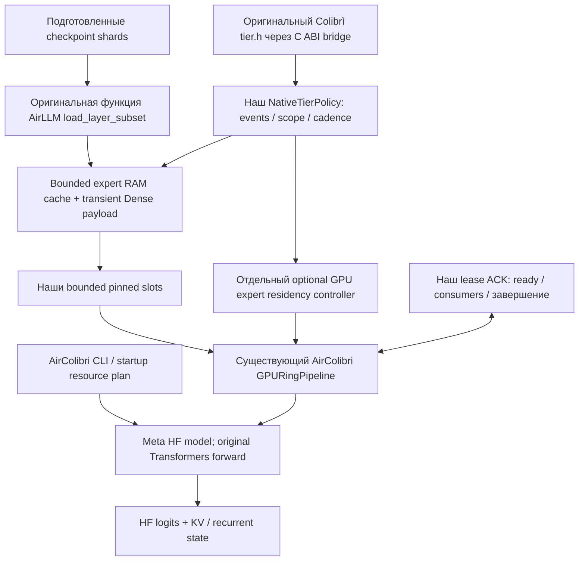

# AirLLM и Colibrì: две исходные топологии до объединения

**13 ноября 2026 · статический разбор закреплённых исходников · интеграция остаётся экспериментальной.**

Это рабочая карта того, кто запускает вычисление, где находятся веса и state, кто ими владеет,
когда можно переиспользовать память и что остаётся после запроса. Оригиналы разобраны отдельно,
чтобы механизм AirColibri не был ошибочно принят за поведение одного из авторских проектов.

## Открыть схемы

| Материал | Содержание |
|---|---|
| [Наглядный атлас](ORIGINALS_TOPOLOGY_RU.html) | Две отдельные обзорные схемы; startup → prefill → decode → reuse → shutdown; таблицы и ссылки |
| [AirLLM: полная карта](AIRLLM_ORIGINAL_TOPOLOGY_RU.md) | Preparation, HF hooks, CPU prefetch, expert specialization, resident/mmap, MLX, LoRA, завершение |
| [Colibrì: полная карта](COLIBRI_ORIGINAL_TOPOLOGY_RU.md) | Family dispatch, CPU caches/PILOT, OLMoE CUDA, common GPU tier, Qwen state, serving, Metal/cluster branches |
| [Функциональное наложение](FUNCTIONAL_OVERLAY_RU.md) | 16 обязанностей, общая логика, различия контрактов и возможное дублирование |
| [План объединения](INTEGRATION_INTERSECTIONS_PLAN_RU.md) | Общие контракты, временные окна T0–T6, этапы E0–E9 и проверки |
| [Сверка Graphify](GRAPHIFY_AUDIT_RU.md) | Два независимых AST-графа, проверенные связи и обнаруженные ограничения извлечения |
| [Указатель исходников](ORIGINALS_SOURCE_INDEX.md) | Revision, файлы, строки, SHA-256, permalinks и пределы покрытия |
| [Машиночитаемый реестр](evidence/2026-11-13/original-topology.json) | Source anchors, hashes, family descriptors, coverage и границы доказательства; без SQL |

## Как читать

**Начало:** получение/подготовка checkpoint, выбор executor, размещение постоянных объектов.
**Середина:** read → размещение → compute → release в пределах слоя и прохода.
**На всём протяжении:** скрытые состояния, память, статистика, worker-ы, синхронизация, ошибки.
**Конец:** завершение token/pass/request отличается от shutdown объекта/process.

На схемах «загружено» означает готовый payload, а «записано событие» ещё не означает завершённый
GPU consumer. Файл checkpoint, OS page cache, owned CPU payload, CUDA pinned memory, device weights
и KV/recurrent state — разные объекты. У каждого должна быть своя граница lifetime.

## Что установлено по исходникам

| Вопрос | AirLLM — основной PyTorch путь | Colibrì — зависит от family/backend |
|---|---|---|
| Кто выполняет model math | Настоящий HF model | Собственные native C/CUDA/Vulkan/Metal paths |
| Кто ведёт token loop | HF `generate`, либо внешний caller | Native generation/serve loop; Python frontend/gateway сверху |
| Главная единица streaming | Модуль/слой; отдельные expert hooks в Kimi K3 | Обычно selected experts, Dense/resident trunk; дополнительные chain/store paths |
| Есть ли фиксированный GPU Ring из AirColibri | Нет в исследованном upstream hook path | Не наш `GPURingPipeline`; собственные slots/tiers/chains |
| Что означает prefetch | Один CPU worker читает следующий streamed-модуль | PILOT прогнозирует будущих экспертов в RAM; device tier имеет другой uploader/streaming lifecycle |
| Есть ли last→first prefetch | `_next_streamed_idx` не замыкает проход | Зависит от выбранного executor; нельзя приписывать всем нашу tail-to-head функцию |
| Кто решает residency | Hook lifecycle; resident exceptions | Cache policy + real cache/tier + budget + backend completion |
| Что делает `tier.h` | Не часть AirLLM | Оценка/выбор, без собственного loader/allocator/token clock |
| Где живёт state | HF/caller; KV либо hybrid recurrent state | Session/model/device mirrors; state-specific reuse/recovery |
| Завершение | Per-module meta eviction; отдельного общего close protocol не найдено | Разные shutdown paths: process lifetime, explicit tier join, chain shutdown, session destroy |

Основные доказательства: A01–A13 и C01–C19 в [реестре](ORIGINALS_SOURCE_INDEX.md).

## Что мы раньше рисковали пропустить

1. **Одинаковая C-функция не воспроизводит оригинальную политику целиком.** В AirColibri
   `NativeTierPolicy` старит heat каждые 100 access events. В GLM `tier_pick_lfru` вызывается
   с per-layer arrays в контексте `REPIN`/emitted tokens; у common GPU tier другой token clock,
   placement classes, promotion budget и период decay. Это наблюдаемое различие, а не доказанная
   причина нулевых hits последнего extended теста. [I01, C10, C15]
2. **Наш общий GPU-кэш и исходный OLMoE CUDA chain имеют разную топологию.** Исходный chain
   требует residency всех экспертов; при недостатке VRAM выбирается CPU path. Наш путь переносит
   выбранные BF16 experts через небольшой Ring и вычисляет HF/PyTorch math. [I02–I04, C11]
3. **В оригинале есть связь веса ↔ растущий state.** OLMoE `kv_room_fit()` сокращает RAM slots
   при росте KV; host pool tier тоже может забрать часть room. Наш startup plan и отдельные guards
   пока не являются общим динамическим ledger всех allocations. [C07, C10, I05]
4. **Prefetch — несколько разных механизмов.** CPU next-module read, PILOT prediction,
   tier uploader и наш CUDA tail-to-head не имеют одного взаимозаменяемого API. Им нужны разные
   readiness, cancellation/stale и ownership contracts. [A04, C09–C13, I04]
5. **Роутинг и размещение нельзя незаметно смешивать.** PILOT не подменяет истинный top-K;
   optional `CACHE_ROUTE` может его изменить. Для сохранения математической эквивалентности
   эти варианты должны иметь отдельные quality/parity criteria. [C08, C16]
6. **Prefill и decode дают разные события reuse.** Native OLMoE группирует rows по экспертам;
   его hit counter включает часть внутрибатчевого reuse. Наш счётчик запросов loader-а имеет
   другую семантику. Сравнивать проценты без определения знаменателя нельзя. [C08, I02]
7. **Переезд вычисления требует переезда актуального state.** KV, DeltaNet, convolution state,
   positions, prefix ledger и иногда RNG/sampling context относятся к executor seam. Перенос
   только tensor weights не создаёт рабочее progressive CPU→GPU подключение. [C11, C14, C17]
8. **У оригиналов разные окончания процесса.** AirLLM не даёт общего close/drain API в этом пути;
   Colibrì имеет несколько разных shutdown contracts. Объединение должно явно определить
   завершение consumers и pending reads до освобождения buffers. [A04, C05, C09–C13]

## Текущее AirColibri — отдельная третья схема

Здесь «существующий/original Ring» означает Ring **существовавшего проекта AirColibri**,
а не класс из авторского AirLLM. Реально перенесённые части: subset reader и C scoring functions.
Reader namespace/backend binding, byte budgets, shared arenas, lifecycle ACKs, event cadence и
HF adapters принадлежат нашей интеграции. Full native Colibrì model executor не подключён.

Поэтому положительные integration tests доказывают корректность данного пути и его границ
на выбранных workloads, но не полноту переноса каждого исходного механизма.

## Следующий порядок объединения, выведенный из карт

Подробное распределение ответственности, стадий и временных окон — в
[плане объединения точек пересечения](INTEGRATION_INTERSECTIONS_PLAN_RU.md).

1. **Зафиксировать один маршрут:** точный checkpoint/family, format, HF/reference version,
   CPU/GPU executor и state layout. Для каждого эксперимента явно записать, какой native path
   сопоставляется с нашим, вместо общего названия «Colibrì».
2. **Нормализовать события и единицы:** token / row / forward / layer / expert request,
   область candidate comparison, clocks/decay, logical read bytes и physical I/O отдельно.
   Сначала trace/replay на сохранённых route IDs; не менять math ради cache hits.
3. **Описать переносимый контракт объекта:** identity/version/format/bytes, место, владелец,
   readiness, consumer completion, cancellation/stale, reservation и failure outcome.
   Подтверждение placement должно отражать фактический backend result.
4. **Связать бюджеты со state:** globals + Dense/expert weights + pinned/staging + scratch +
   KV/recurrent/native buffers. Перед admit/prefetch/shrink учитывать весь актуальный объём,
   проверять backpressure и порядок освобождения, а не суммировать только веса.
5. **Переносить по одному механизму:** сначала matched policy trace, затем CPU-read prefetch,
   затем device residency; каждый раз off/shadow/apply, exact routes/state/logits и latency/memory.
   Native executor/state migration — отдельный следующий этап с независимой проверкой чисел.
6. **Проверить lifetime на конце и отказе:** last→first, следующий request, cancel, read failure,
   device fallback, close/reopen; ни один pending consumer не должен видеть перезаписанный payload.

Это план после source-аудита, не перечень уже реализованных возможностей. Новые integration
изменения по этой карте в данном проходе не делались.

## Отдельно: законченные до этого аудита проверки compact slots

Результаты сохранены в [отчёте compact MoE](COMPACT_MOE_RESULTS_2026-11-13.md): arena с двумя
retained experts сокращена с **184 до 70 MiB** в каждом из GPU и pinned tiers. Extended trace
128 prefill + 16 fixed inputs совпал с независимым reference по **855 168 last-position logits**,
routes и KV hashes. На нём **0 GPU hits из 2 950 expert requests**; ускорение не установлено.
Это важный повод проверить семантику политики, а не объявлять объединение завершённым.

## Полнота и сохранность

Исследованы local upstream checkouts указанной revision; remote HEAD не объявляется текущим.
Исходники оригиналов и checkpoint weights не редактировались. Артефакты находятся в основной
папке `C:\air-colibri\docs`; копии проектов не создавались.

Карты покрывают end-to-end lifecycle и явно разветвляют архитектуры/backend-ы. Сверка каждой
арифметической операции всех engines, runtime запуска каждого backend и native performance
matrix остаются за пределами этого source-аудита. Ссылки на строки, hashes и coverage записаны
так, чтобы продолжать с нужного узла схемы, не искать заново по всем документам.
